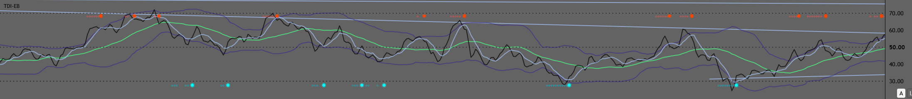
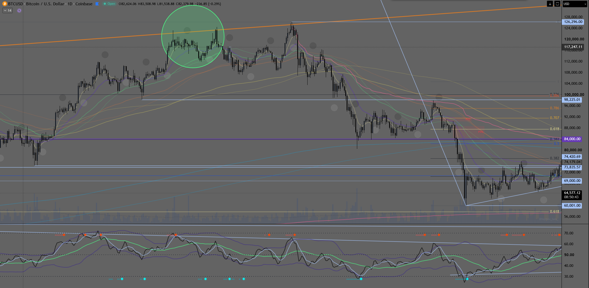

# TDI-EB: Traders Dynamic Index with Sharkfin Signals

A TradingView indicator (Pine Script v6) built on Dean Malone's Traders Dynamic Index (TDI). It flags **sharkfin** setups: the RSI price line moves outside its volatility band, then turns back across its signal line.

- **Warning:** a small `∘` marker on every bar where the price line is outside the band.
- **Signal:** a `✹` marker when the price line crosses its signal line after leaving the band. It fires **once per excursion**.
- **Alerts:** built-in alert conditions for both the warning and the signal, in each direction.

---

## Example

BTCUSD daily chart (Coinbase) with TDI-EB in the lower pane:

---

## How it works

### TDI components

| Line | Calculation | Default | Color |
|---|---|---|---|
| RSI | `ta.rsi(close, RSI Period)` | 21 | *(not plotted)* |
| Price Line | SMA of RSI | 2 | Black |
| Signal Line | SMA of RSI | 7 | Light blue |
| Middle of Bands | SMA of RSI over Band Length | 34 | Green |
| Upper / Lower Band | Middle ± (Band Multiplier × stdev of RSI) | 1.6185 | Purple |
| Reference levels | 70 / 50 / 30 | n/a | Dotted |

### Sharkfin logic

Each direction has its own small state machine:

1. **Arm.** The price line closes outside the band (above the upper band for a bearish fin, below the lower band for a bullish fin). Only the *start* of a new excursion arms the signal. If a fin has already fired, it can't fire again until the line comes back inside and leaves the band again.
2. **Window.** The signal stays armed until **Max bars after leaving band** bars have passed since the *last* bar the line was outside the band.
3. **Trigger.** The signal fires on the first bar where:
   - **Default mode:** the price line crosses the signal line back toward the mean (a crossunder for a sell, a crossover for a buy). This can happen while the line is still outside the band.
   - **Re-entry mode** (`Require price line back inside band` on): the price line is back inside the band **and** on the far side of the signal line. This is the stricter "completed fin" reading. It usually produces fewer, later signals.
4. **Disarm.** After the signal fires, that side stays quiet until the next excursion.

| Marker | Location | Meaning |
|---|---|---|
| Red `∘` | Top | Price line above the upper band (bearish fin forming) |
| Cyan `∘` | Bottom | Price line below the lower band (bullish fin forming) |
| Orange `✹` | Top | Bearish sharkfin signal |
| Cyan `✹` | Bottom | Bullish sharkfin signal |

---

## Inputs

| Input | Default | Description |
|---|---|---|
| RSI Period | 21 | RSI length. (Malone's original TDI uses 13.) |
| Band Length | 34 | Lookback for the band basis and standard deviation |
| Band Multiplier | 1.6185 | Standard deviation multiplier for the bands |
| Price Line (fast MA of RSI) | 2 | SMA length for the price line |
| Signal Line (slow MA of RSI) | 7 | SMA length for the signal line |
| Max bars after leaving band | 10 | How long after the last out-of-band bar a cross still counts |
| Require price line back inside band | Off | Switches to re-entry mode (see above) |
| Signal only on closed bars | On | Hides signals on the live bar until it closes, so markers don't appear and then vanish |

---

## Installation

1. In TradingView, open the **Pine Editor** at the bottom of the chart.
2. Create a new indicator and replace its contents with [`TDI-EB.pine`](TDI-EB.pine).
3. Click **Save**, then **Add to chart**.

## Alerts

Right-click the indicator (or click the alarm clock icon), choose **Add alert**, and set **Condition** to `TDI-EB` along with one of these:

| Alert | Fires when |
|---|---|
| TDI warning: above upper band | The first bar of a new excursion above the upper band |
| TDI warning: below lower band | The first bar of a new excursion below the lower band |
| TDI sharkfin SELL | A bearish sharkfin signal |
| TDI sharkfin BUY | A bullish sharkfin signal |

Set the frequency to **Once Per Bar Close**. The warning conditions are evaluated on the live bar, so any other frequency can alert on a band break that's gone by the time the bar closes.

---

## Notes

- Signals are confirmed only when the bar closes. On historical bars, what you see is what would have fired in real time when "Signal only on closed bars" is on.
- This is an indicator, not a strategy, so it doesn't backtest. To measure the signals, convert it to a `strategy()` script and use `buyFin` / `sellFin` as entry conditions.

## Credits

- **Dean Malone** created the Traders Dynamic Index.
- Modified and maintained by **Evan Barth** ([evanbarth.com](https://evanbarth.com)).

## Disclaimer

This is for educational purposes only and is not financial advice. Trade at your own risk.

## License

[MIT](LICENSE)
